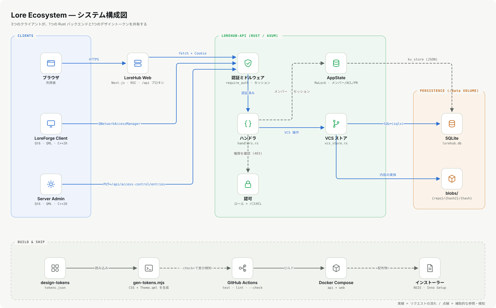

# LoreDesktopAndWebSystem

LoreのGUI操作ができるアプリケーション及びwebサービスの開発を目的としたリポジトリ

架空の「巨大バイナリ対応の次世代VCS」**Lore** を中心に、3つの独立コンポーネントで構成される。

| コンポーネント | 役割 | 立ち位置の例え |
|---|---|---|
| [`lorehub-web`](lorehub-web/) | ブラウザからリポジトリ閲覧・PR・権限管理 | GitHub / GitLab |
| [`lorehub-api`](lorehub-api/) | 上記2クライアントが共有するRust(Axum)バックエンド | — |
| [`loreforge-client`](loreforge-client/) | デスクトップのVCSクライアント(Qt6/QML/C++20) | Fork / GitKraken |
| [`loreforge-server-admin`](loreforge-server-admin/) | Loreサーバー環境をGUIで構築・管理(Qt6/QML/C++20) | Docker Desktop + 権限エディタ |



## 主な機能

- **実コンテンツアドレス方式のVCS**: `lorehub-api` はSHA-256による実ハッシュ化・重複排除・全バージョン履歴保持・ブランチ分岐・行レベルdiffを備えた正規化SQLバックエンドで動作する(以前はコミットハッシュがランダム値、ツリーが全リポジトリ共有の静的スナップショットという「シミュレーション」だった。詳細は `docs/ARCHITECTURE_AND_DESIGN.md` §5)。
- **セキュリティ**: パスベースACL(ディレクトリ単位、祖先探索方式)の実強制、組織操作(リポジトリ削除・ロール変更・招待・ACL適用・権限のtoggle)のRBACゲート(toggle は2026-10に、ロール確認が無かった穴を修正)、セキュアCookie・CORSオリジン制限・リクエストボディ上限・ログインのIPレート制限。
- **アカウントライフサイクル**: 自己サービスのパスワード変更、メンバー招待(承認制・自動ログイン付き)、パスワード忘れ/リセット(メール送信、SMTP未設定時はログ出力にフォールバック)。
- **UI**: 3列のリポジトリ画面(ツリー・内容・サマリ)、決めごとに沿った表示(ハッシュは7桁でクリックコピー、日時は相対+絶対、差分は色+記号)、書き込み失敗の理由表示、404・空状態(アスキーの木)。デザイン値は `design-tokens/tokens.json` の1か所から、WebのCSSと両Qtアプリの `Theme.qml` を生成する。
- **デプロイ**: `docker-compose.yml` によるRust/Next.jsの2サービス構成(`cap_drop: ALL`・`no-new-privileges`)、GitHub Actions CI、`/api/health` ヘルスチェック、Vercel等クロスドメイン配置向けのAPIプロキシ(`NEXT_PUBLIC_USE_API_PROXY`)。詳細は `docs/DEPLOYMENT.md`。
- **可観測性**: `/metrics`(Prometheus形式)とJSON構造化ログ(`LOREHUB_LOG_FORMAT=json`)。
- **デスクトップ配布**: LoreForge Client/Server AdminともWindowsインストーラー(.exe、NSIS/CPack)を生成可能。詳細は `docs/DESKTOP_PACKAGING.md`。
- **自動テスト**: `lorehub-api`(統合テスト123件)・`lorehub-web`(Vitest 44件)・LoreForge Client/Server Admin(Qt Test)・図のレンダラー(`node:test` 12件)の5系統。
- **図のコード化**: 図は `tools/diagrams/specs/` の仕様から生成し、単体SVG(`docs/diagrams/`)とHTML資料へ同時に埋め込む。

## はじめに(保守・拡張する人へ)

```bash
# 1) API(Rust)
cd lorehub-api && cargo test && cargo run          # http://localhost:4000

# 2) Web(Next.js)
cd lorehub-web && npm ci && npm test && npm run dev  # http://localhost:3000

# 3) まとめて(Docker)
cp .env.example .env && docker compose up --build

# 4) 生成物
node tools/gen-tokens.mjs           # デザイントークン → Web CSS と Theme.qml
node tools/diagrams/build.mjs       # 図の仕様 → SVG と HTML
```

デモのログイン: `aiko.tanaka@nebula.studio` / `lorehub`。仕組みを基礎から学ぶなら [学習資料](docs/learning/00-start-here.md) から。

## ドキュメント

- [`docs/ARCHITECTURE_AND_DESIGN.md`](docs/ARCHITECTURE_AND_DESIGN.md) — アーキテクチャ・データフロー・設計判断(Mermaid図)
- [`docs/TECHNICAL_REFERENCE.md`](docs/TECHNICAL_REFERENCE.md) — セットアップ・APIリファレンス・実装詳細
- [`docs/LECTURE_NOTES.md`](docs/LECTURE_NOTES.md) — 設計判断の「なぜ」を学ぶ講義資料(認可の穴の見つけ方・失敗を見せるUI・図のコード化を含む12章)
- [`docs/learning/`](docs/learning/00-start-here.md) — **学習資料**: HTTP・Rust・SQL・アルゴリズム・スクリプトから拡張の手順まで、基礎から順に学ぶ14章
- [`docs/DEPLOYMENT.md`](docs/DEPLOYMENT.md) — Docker Composeでのデプロイ手順
- [`docs/DESKTOP_PACKAGING.md`](docs/DESKTOP_PACKAGING.md) — デスクトップアプリのインストーラー生成
- [`docs/lore-ecosystem-docs.html`](docs/lore-ecosystem-docs.html) — 上記を1ページに集約したスタンドアロンHTML資料
