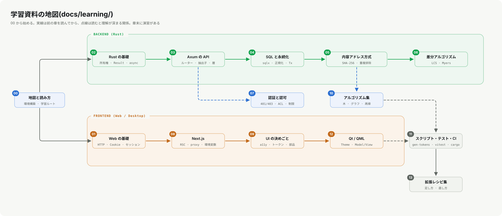

# 00. 地図と読み方

この資料は、Lore Ecosystem を**保守し、拡張できる**ようになるための講義です。設計の「なぜ」を語る [講義資料](../LECTURE_NOTES.md) や、仕様を引く [技術資料](../TECHNICAL_REFERENCE.md) とは別に、**基礎から順に、実コードを読み・動かし・直す**ことを目的にしています。



## 0.1 想定読者と前提

- プログラミングの経験が少しある(変数・関数・条件分岐・配列が分かる)
- ターミナルでコマンドを打てる

Rust も、SQL も、HTTP も、Qt も、**知らなくてよい**です。必要になった章で、基礎から説明します。逆に、すでに知っている章は読み飛ばして構いません(各章の冒頭に「この章で分かること」を置いています)。

## 0.2 学び方の約束

1. **動かす。** 読むだけで終わらせず、各章のコマンドを実際に打つ。出力が書いてある所は、自分の出力と見比べる。
2. **壊す。** 理解は「わざと壊して、どう壊れるか見る」ことで深まる。章末の演習は、そのための足場。
3. **実コードは、関数名で探す。** この資料は実際のコードを引用しますが、行番号は変わります。`handlers.rs` の `require_auth` のように、**ファイルと関数名**で書いてあるので、検索で見つけてください。
4. **資料も疑う。** 資料とコードが食い違ったら、コードが正しい。気づいたら資料を直す(それも保守の仕事)。

## 0.3 準備: 必要な道具

| 道具 | 用途 | 必須? | 確認 |
|---|---|---|---|
| Rust(stable、edition 2024 が通るもの) | `lorehub-api` | 02〜07章 | `rustc --version` |
| Node.js 20 以上 | `lorehub-web`、`tools/` | 08〜11章 | `node --version` |
| Python 3 | DB を読む演習(標準の `sqlite3` モジュール) | 04・05章 | `python --version` |
| Qt 6.8 と MSVC(Windows) | `loreforge-*` | 12章だけ | 12章を参照 |
| Docker | まとめて起動 | 任意 | `docker version` |

> **メモ**: `sqlite3` コマンドは入っていなくても大丈夫です。この資料では、Python の標準ライブラリで DB を読みます。

## 0.4 まず動かす

ターミナルを2つ使います。

```bash
# ターミナル1: API(Rust)。初回はビルドに数分かかる
cd lorehub-api
cargo run
# → "lorehub-api listening on http://0.0.0.0:4000"
```

```bash
# ターミナル2: 生存確認
curl http://localhost:4000/api/health
# → {"status":"ok"}
```

```bash
# ターミナル2: Web(Next.js)
cd lorehub-web
npm ci
npm run dev
# → http://localhost:3000/login を開く
```

ログインは `aiko.tanaka@nebula.studio` / `lorehub`(デモ用の共通パスワード)。リポジトリ一覧が出れば成功です。

> **注意**: `cargo run` した場所に `lorehub.db`(SQLite)と `blobs/`(ファイルの実体)ができます。消せば、次の起動で初期データから作り直されます。

## 0.5 リポジトリの地図

```
LoreDesktopAndWebSystem/
├── lorehub-api/            Rust (Axum) のバックエンド。2つのクライアントが共有する   → 02〜07章
│   ├── src/handlers.rs       各エンドポイントの処理
│   ├── src/authz.rs          パスACLの判定
│   ├── src/vcs_store.rs      コミット・ブランチ・ツリーのSQL
│   ├── src/blob_store.rs     ファイル実体の保存
│   ├── migrations/           DBスキーマ(sqlx が起動時に適用)
│   └── src/tests/            統合テスト
├── lorehub-web/            Next.js のフロントエンド                                  → 08・09章
├── loreforge-client/       Qt/QML のデスクトップクライアント                          → 12章
├── loreforge-server-admin/ Qt/QML のサーバー管理アプリ                                → 12章
├── design-tokens/          色・角丸などの値の定義元(tokens.json)                     → 11章
├── tools/                  gen-tokens.mjs(トークン生成)と diagrams/(図の生成)         → 11章
└── docs/                   文書。diagrams/(生成された図)と learning/(この資料)
```

## 0.6 学習ルート

| あなたは | 読む順 |
|---|---|
| バックエンドを引き継ぐ | 00 → 01 → 02 → 03 → 04 → 05 → 07 → 06 → 10 → 11 → 13 |
| フロントエンドを引き継ぐ | 00 → 01 → 08 → 09 → 10 → 11 → 13(API は 03 の前半だけ) |
| デスクトップ(Qt)を引き継ぐ | 00 → 01 → 12 → 11 → 13 |
| まず全体像がほしい | 00 → 01 → 05 → 07 → 08(各章の最初と「まとめ」だけ)→ [ARCHITECTURE_AND_DESIGN](../ARCHITECTURE_AND_DESIGN.md) |

## 0.7 用語集

| 用語 | 意味 |
|---|---|
| VCS | バージョン管理システム。ファイルの履歴を残す(Git、Perforce など) |
| コミット | ある時点の変更をまとめて記録したもの。ハッシュ(識別子)を持つ |
| ブランチ | コミットの履歴の「枝」。実体は「どのコミットを指すか」の名前つきポインタ |
| ブロブ(blob) | ファイルの**内容そのもの**(名前を持たない)。このシステムではファイルシステムに保存する |
| コンテンツアドレス方式 | 内容のハッシュを、その内容の「住所」にする保存方式。同じ内容は1つしか保存されない |
| ACL | アクセス制御リスト。「誰が、どのパスに、何をできるか」の表 |
| RBAC | ロールベースのアクセス制御。「Owner/Admin/Member」のような役割で操作を許す |
| 401 / 403 | 401=誰か分からない(認証されていない)/ 403=誰かは分かったが許可がない |
| RSC / SSR | React Server Components / Server-Side Rendering。HTML をサーバーで組み立てる |
| 生成物 | 手で書かず、元から作られるファイル(`Theme.qml`、`docs/diagrams/*.svg` など)。直す時は元を直す |

## 0.8 章の一覧

| 章 | 題 | 身につくこと |
|---|---|---|
| [01](01-web-basics.md) | Web の基礎 | HTTP・Cookie・セッションを `curl` で触って理解する |
| [02](02-rust-basics.md) | Rust の基礎 | 所有権・`Option`/`Result`・`async` を、このコードを読む範囲で |
| [03](03-axum-api.md) | Axum の API | ルーター・ハンドラ・ミドルウェア・テスト |
| [04](04-sql-and-storage.md) | SQL と永続化 | SQL の基礎、トランザクション、マイグレーション |
| [05](05-content-addressing.md) | 内容アドレス方式の VCS | ハッシュ、重複排除、コミットの作り方 |
| [06](06-diff-algorithm.md) | 差分アルゴリズム | LCS から diff を自作し、`similar` と見比べる |
| [07](07-auth-and-authz.md) | 認証と認可 | パスワード、セッション、401/403、ACL、レート制限 |
| [08](08-nextjs-frontend.md) | Next.js | サーバーコンポーネント、プロキシ、環境変数の時期 |
| [09](09-ui-rules.md) | UI の決めごと | アクセシビリティ、共通部品、トークン |
| [10](10-algorithms.md) | アルゴリズム集 | 木・グラフ・再帰・丸め |
| [11](11-tooling-and-ci.md) | スクリプト・テスト・CI | 生成物の仕組みと、壊さないための道具 |
| [12](12-qt-qml.md) | Qt / QML | シングルトン、モデル/ビュー、Cookie の罠 |
| [13](13-extend-recipes.md) | 拡張レシピ集 | 足し方・直し方を、手順と確認コマンドつきで |

## 0.9 つまずいたら

- 「実行したら違う出力が出た」→ バージョン差か、前に動かした状態が残っている(`lorehub.db` を消す)。
- 「ポートが使われている」→ 前回の `lorehub-api` が残っている。タスクマネージャーかプロセス一覧で止める。
- 「ログインできない」→ [13章の「ログインできないとき」](13-extend-recipes.md#139-ログインできないとき) の決定木へ。
