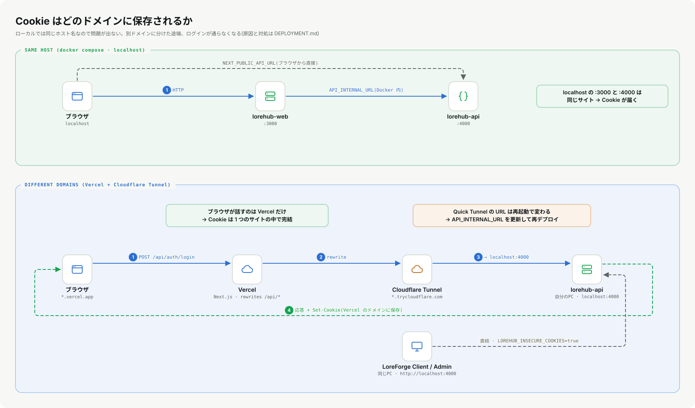

# 01. Web の基礎: HTTP・Cookie・セッション

**この章で分かること**: HTTP のやりとり、ステータスコード、Cookie が何を保存して何を保存しないか、このシステムのログインの仕組み(JWT ではなく**サーバー側のセッション**)、CORS が守っているもの。全部 `curl` で触ります。

前提: [00](00-start-here.md) の手順で `lorehub-api` が `localhost:4000` で動いていること。

## 1.1 HTTP は「頼む → 答える」だけ

HTTP は、クライアントが**要求(request)**を送り、サーバーが**応答(response)**を返すだけの単純なやりとりです。

```
要求:  メソッド  パス        ヘッダー...          本文
       GET     /api/health  Accept: */*
応答:  ステータス  ヘッダー...             本文
       200 OK    Content-Type: application/json   {"status":"ok"}
```

```bash
curl -i http://localhost:4000/api/health
```

`-i` は応答のヘッダーも表示します。1行目の `HTTP/1.1 200 OK` がステータス行です。

### メソッド

| メソッド | 意味 | このシステムの例 |
|---|---|---|
| GET | 読む(状態を変えない) | `GET /api/repositories` |
| POST | 作る・実行する | `POST /api/auth/login`、`POST /api/repositories/{slug}/commits` |
| PATCH | 一部を直す | `PATCH /api/repositories/{slug}` |
| PUT | まるごと置き換える | `PUT /api/access-control/entries` |
| DELETE | 消す | `DELETE /api/repositories/{slug}` |

### ステータスコード(このシステムが使うもの)

| コード | 意味 | 出てくる場面 |
|---|---|---|
| 200 / 201 / 204 | 成功 / 作成した / 成功で本文なし | 取得 / アップロード・コミット / 忘れたパスワード要求 |
| 400 | 要求が不正 | 空のパス、不正な base64、ステージが空のコミット |
| **401** | **誰か分からない** | Cookie が無い・期限切れ |
| **403** | **誰かは分かったが許可がない** | 一般メンバーが管理操作をした |
| 404 | 無い | 存在しないリポジトリ |
| 413 | 本文が大きすぎる | ボディ上限(既定 48 MiB)超過 |
| 429 | 多すぎる | ログインの試行回数制限 |
| 500 | サーバーの不具合 | ファイルの保存に失敗 |

> **401 と 403 を混ぜない**のが重要です。401 を受けたクライアントは「ログインし直す(またはトークンを更新する)」べきで、403 を受けたら「ログインし直しても無駄、許可が無い」と伝えるべきです。混ぜると、画面はどちらをすべきか決められません。詳しくは [07](07-auth-and-authz.md)。

## 1.2 Cookie: ブラウザが覚えて、毎回付けてくれる値

HTTP は「前の要求を覚えていない」(ステートレス)ので、「ログイン済み」を覚えておく仕掛けが要ります。その代表が **Cookie** です。

1. サーバーが応答に `Set-Cookie: 名前=値; 属性...` を付ける
2. ブラウザ(や Qt)がそれを保存する
3. **以後、同じサイトへの要求に** `Cookie: 名前=値` を自動で付ける

実際にログインして、`Set-Cookie` を見ます。

```bash
curl -i -c jar.txt -H "Content-Type: application/json" \
  -d '{"email":"aiko.tanaka@nebula.studio","password":"lorehub"}' \
  http://localhost:4000/api/auth/login
```

応答に、次のような行が2本出ます(値は毎回違います)。

```
set-cookie: lorehub_token=3f9a...; Path=/; HttpOnly; SameSite=Lax; Max-Age=1800
set-cookie: lorehub_refresh=b21c...; Path=/; HttpOnly; SameSite=Lax; Max-Age=604800
```

`-c jar.txt` は「受け取った Cookie を `jar.txt` に保存する」指定です(ブラウザの Cookie 保管庫の代わり)。

### Cookie の属性

実装は [`auth.rs`](../../lorehub-api/src/auth.rs) の `cookie_string` にあります。

```rust
format!("{name}={value}; Path=/; HttpOnly; SameSite=Lax{secure_attr}; Max-Age={max_age}")
```

| 属性 | 意味 | なぜ付けるか |
|---|---|---|
| `Path=/` | このサイト全体に送る | |
| `HttpOnly` | **JavaScript から読めない** | XSS(悪意あるスクリプト)でトークンを盗まれにくくする |
| `SameSite=Lax` | 他サイトからの「うっかり送信」を制限 | CSRF(他サイトからの勝手な操作)を和らげる |
| `Secure` | **HTTPS のときだけ**保存・送信する | 平文で盗聴されない。既定で付く(`LOREHUB_INSECURE_COOKIES=true` で外す) |
| `Max-Age=1800` | 1800秒(30分)で消える | アクセストークンの寿命。リフレッシュは 7 日 |

> **`Secure` は罠にもなる。** HTTP(`http://localhost:4000`)に対して `Secure` 付きの Cookie を返すと、ブラウザも Qt も**保存しません**。デスクトップクライアントが「ログインできたのにリポジトリ一覧が 401」になった実際の原因です([12章](12-qt-qml.md))。

## 1.3 セッション: Cookie の中身は「ただの合言葉」

`lorehub_token` の値は **24 バイトの乱数を16進にした48文字**です([`auth.rs`](../../lorehub-api/src/auth.rs) の `generate_token`)。それ自体には何の情報も入っていません。

```rust
pub fn generate_token() -> String {
    let bytes: [u8; 24] = rand::thread_rng().r#gen();
    bytes.iter().map(|b| format!("{b:02x}")).collect()
}
```

意味は**サーバー側の表**にあります。`AppState.sessions`(トークン → ユーザーのメールと有効期限)です。要求が来たら、サーバーが表を引きます。

```
Cookie: lorehub_token=3f9a...  ──▶  sessions["3f9a..."] = { email: "aiko...", expires_at: ... }
```

これを**サーバーサイド・セッション(不透明トークン)**と呼びます。よく比べられる **JWT**(トークン自体に情報と署名が入る)とは違います。

| | 不透明トークン + サーバー側の表(このシステム) | JWT |
|---|---|---|
| 中身 | 乱数。意味はサーバーだけが知る | 情報+署名。誰でも中身を読める |
| 取り消し | 表から消せば**即座に**無効 | 期限まで有効(別途、失効リストが要る) |
| 検証のコスト | 毎回、表を引く(ここではメモリ上の `HashMap`) | 署名の検証だけ(表は不要) |
| 向く場面 | 1つのサーバーで完結する・すぐ失効したい | 複数のサーバーで表を共有したくない |

このシステムは1つの API サーバーで完結するので、取り消しが簡単な前者を選んでいます(ログアウトは表から消すだけ)。

### アクセストークンとリフレッシュトークン

| | アクセストークン | リフレッシュトークン |
|---|---|---|
| Cookie 名 | `lorehub_token` | `lorehub_refresh` |
| 寿命 | 30 分 | 7 日 |
| 用途 | 毎回の API 呼び出し | 期限切れのとき、新しいトークンを**もらう** |

寿命が短いトークンで毎回の要求を守り、盗まれても被害が短時間で済むようにする代わりに、長寿命のリフレッシュトークンで「ログインし直し」を避けます。リフレッシュは使うたびに作り直し(ローテーション)、古いものは使えなくなります。

## 1.4 触って確かめる

```bash
# Cookie なしで保護された API を呼ぶ → 401
curl -i http://localhost:4000/api/auth/me
# HTTP/1.1 401 Unauthorized   {"error":"unauthorized"}

# 保管庫(jar.txt)の Cookie を付けて呼ぶ → 200 とユーザー情報
curl -s -b jar.txt http://localhost:4000/api/auth/me

# 嘘のトークンを付ける → やはり 401(表に無い)
curl -i -H "Cookie: lorehub_token=00" http://localhost:4000/api/auth/me
```

`-b jar.txt` は「保管庫の Cookie を付けて送る」指定です。

## 1.5 同じサイト、違うサイト(Cookie の範囲)

Cookie は、**それを返したドメイン**にだけ保存され、そのドメインへの要求にだけ付きます。

- `localhost:3000` と `localhost:4000` は、ポートが違っても**同じサイト**(ホスト名が同じ)。Cookie は共有されます。
- `my-app.vercel.app` と `xxxx.trycloudflare.com` は**別のサイト**。API が返した Cookie は、Web アプリのドメインには**存在しません**。

ローカルでは気づかず、別ドメインに置いた途端に「ログインできない」になる典型です。解決は「ブラウザに API のドメインを見せない」こと([08章](08-nextjs-frontend.md)、[DEPLOYMENT.md](../DEPLOYMENT.md))。



## 1.6 CORS: 「他のサイトの JavaScript に、勝手に読ませない」

ブラウザは、サイト A のページの JavaScript が、サイト B の API を呼ぶことを**既定で止めます**(同一オリジンポリシー)。B が「A からならよい」と応答ヘッダーで許可したときだけ通ります。これが **CORS** です。

- オリジン = `スキーム + ホスト + ポート`(例: `http://localhost:3000`)。
- Cookie を付けて呼ぶとき(`credentials: "include"`)は、許可するオリジンに `*`(全部)を指定できません。
- このシステムは `LOREHUB_WEB_ORIGIN` に**1つだけ**書いたオリジンを許可します([`main.rs`](../../lorehub-api/src/main.rs) の `build_router`)。

CORS は**ブラウザの約束**です。`curl` はそもそも守りません。CORS は「他サイトのページが、ログイン中のあなたの権限で API を叩く」ことを防ぐもので、API の認可の代わりにはなりません。

## 1.7 まとめ

- HTTP = 要求と応答。メソッドとステータスコードで意味を表す。
- Cookie = サーバーが `Set-Cookie` で渡し、ブラウザが毎回付ける。`HttpOnly`・`SameSite`・`Secure` で守る。
- このシステムの Cookie の値は**乱数の合言葉**で、意味はサーバーの `sessions` にある。
- **401 = 誰か分からない / 403 = 許可がない。**
- Cookie は返したドメインにだけ保存される。別ドメイン構成が「ログインできない」を生む。

## 1.8 演習

1. `curl -i` で `POST /api/auth/login` を**間違ったパスワード**で呼び、ステータスを確認する。(ヒント: 401。「ユーザーがいない」と「パスワードが違う」で応答が変わらないのは、なぜ良い設計か?)
2. 保管庫 `jar.txt` を開き、Cookie が2本あることと、`HttpOnly` を示す印(`#HttpOnly_` の接頭辞)を探す。
3. `POST /api/auth/logout` を呼んだ後に、同じ `jar.txt` で `GET /api/auth/me` を呼ぶ。結果と、その理由(表から消えた)を説明する。
4. **考える**: アクセストークンの寿命を 30 分から 5 分に縮めると、何が良くなり、何が不便になるか。リフレッシュが無い場合は?

<details>
<summary>演習1・3のヒント</summary>

1. 「ユーザーが存在しない」と「パスワードが違う」を区別して返すと、攻撃者が**登録済みのメールアドレスを調べられて**しまいます。どちらも同じ 401 にします。
3. `logout` は `sessions` と `refresh_tokens` から該当のトークンを消します。ブラウザの Cookie が残っていても、サーバーの表に無いので 401 になります。

</details>

次: [02. Rust の基礎](02-rust-basics.md)
