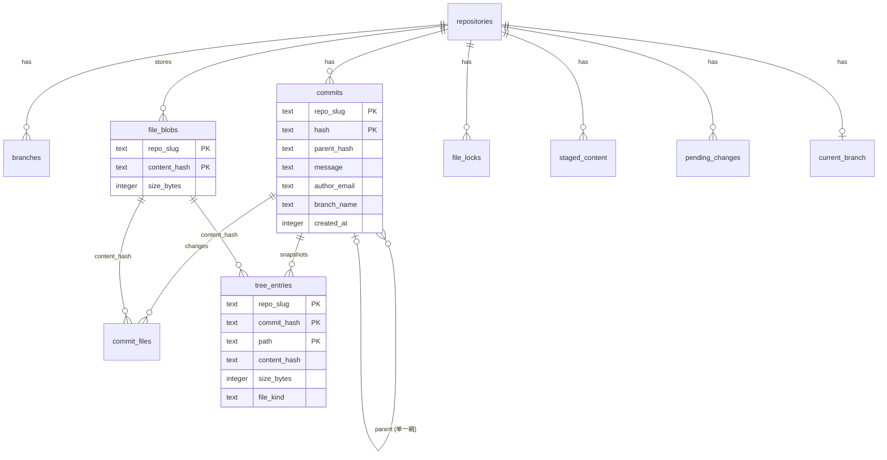

# 04. SQL と永続化

**この章で分かること**: SQL の基礎(読む・書く・結ぶ)、キーと制約、トランザクション、マイグレーション。そして、このシステムが**2種類の保存方式を併用している理由**。実際の `lorehub.db` を Python で読みながら進めます。

前提: [00](00-start-here.md)(Python が使えること)。Rust は読めなくても進められます。

## 4.1 データベースを手元で覗く

SQLite は**1つのファイル**がデータベースです。`lorehub-api` を `cargo run` した場所にできる `lorehub.db` を、Python の標準ライブラリで読めます。

```python
# peek.py  — API を止めなくても読める(読み取りだけなら安全)
import sqlite3

db = sqlite3.connect("lorehub-api/lorehub.db")
db.row_factory = sqlite3.Row                       # 列名で取り出せるようにする

print([r[0] for r in db.execute("select name from sqlite_master where type='table' order by name")])
```

出力(順番は名前順):

```
['_sqlx_migrations', 'branches', 'commit_files', 'commits', 'current_branch', 'file_blobs',
 'file_locks', 'kv_store', 'pending_changes', 'repositories', 'staged_content', 'tree_entries']
```

> **注意**: 覗くのは読み取りだけにします。API が動いている間に書き込むと、アプリの状態とずれます。書き込みを試す演習は、**必ず `lorehub.db` のコピー**で行います。

## 4.2 SQL の基礎

テーブルは「表」です。1行が1件、1列が1つの項目です。

```sql
SELECT 列, 列 FROM テーブル WHERE 条件 ORDER BY 列 LIMIT 件数;     -- 読む
INSERT INTO テーブル (列, 列) VALUES (値, 値);                      -- 足す
UPDATE テーブル SET 列 = 値 WHERE 条件;                             -- 直す
DELETE FROM テーブル WHERE 条件;                                    -- 消す
```

**`WHERE` を付け忘れた `UPDATE` / `DELETE` は全行に効きます。** 習慣として、先に同じ `WHERE` で `SELECT` して、対象を目で確かめます。

### 集計とグループ

```sql
SELECT repo_slug, count(*) AS n, min(created_at) AS first, max(created_at) AS last
FROM commits
GROUP BY repo_slug
ORDER BY n DESC;
```

実行すると、各リポジトリのコミット数と最初・最後の時刻(Unix 秒)が出ます(デモデータでは各7件)。

### 結合(JOIN): 2つの表を結ぶ

```sql
SELECT c.hash, c.message, cf.path, cf.change_type
FROM commits c
JOIN commit_files cf
  ON cf.repo_slug = c.repo_slug AND cf.commit_hash = c.hash
WHERE c.repo_slug = 'audio-master'
ORDER BY c.created_at;
```

`ON` が「どの行同士を結ぶか」です。キーが**複数列**(`repo_slug` と `hash`)なので、両方を結びます。

## 4.3 キーと制約 — データを壊れにくくする

実際のスキーマは [`migrations/0001_vcs_schema.sql`](../../lorehub-api/migrations/0001_vcs_schema.sql) が一次情報です(`sqlx` が起動時に適用します)。



| 仕組み | 例 | 何を守るか |
|---|---|---|
| **主キー** `PRIMARY KEY` | `commits (repo_slug, hash)` | 同じ行が2つ入らない。**複数列で1つのキー**にできる |
| **外部キー** `FOREIGN KEY ... REFERENCES` | `tree_entries.content_hash → file_blobs` | 存在しない相手を指せない |
| **`ON DELETE CASCADE`** | すべての `repo_slug` | 親(リポジトリ)を消すと、子(コミット、ツリー…)が**自動で消える** |
| **`CHECK`** | `change_type IN ('added','modified','deleted')` | 決まった値以外が入らない |

### なぜ主キーが `(repo_slug, hash)` なのか

リポジトリごとに履歴が独立しているからです。別のリポジトリで偶然(またはコピーで)同じハッシュが現れても、別物として扱えます。実際、デモデータでは同じ内容のブロブが複数のリポジトリに**それぞれ**存在します(重複排除は**リポジトリの中**でだけ働きます)。

### `ON DELETE CASCADE` を試す(コピーで!)

```python
import sqlite3, shutil
shutil.copy("lorehub-api/lorehub.db", "copy.db")          # 必ずコピーで
db = sqlite3.connect("copy.db")
db.execute("PRAGMA foreign_keys=ON")                      # ← これが要る(後述)
slug = "audio-master"
db.execute("delete from repositories where slug=?", (slug,))
db.commit()
print(db.execute("select count(*) from commits where repo_slug=?", (slug,)).fetchone())   # (0,)
```

リポジトリの1行を消しただけで、コミット 7 件、ツリー 50 行、コミットのファイル 14 行、ブランチ 3 本、ブロブのメタ情報 14 行が**まとめて 0 になる**のを確かめました。`DELETE /api/repositories/{slug}` が1文で済むのは、これのおかげです。

> **罠: SQLite は外部キーが既定で「無効」。** 接続のたびに `PRAGMA foreign_keys = ON` が要ります。忘れると、制約も `CASCADE` も**黙って効きません**(エラーも出ません)。`lorehub-api` は [`db.rs`](../../lorehub-api/src/db.rs) の `connect` で、接続の設定として有効にしています。上のコードで `PRAGMA` を消して、結果が変わることを確かめてください。

## 4.4 `sqlx` で SQL を書く

Rust からは `sqlx` を使います。このコードは、SQL を**文字列で書き、`bind` で値を渡す**形です。

```rust
let rows = sqlx::query(
    "SELECT path, change_type, content_hash, size_bytes FROM pending_changes WHERE repo_slug = ?1",
)
.bind(repo_slug)                    // ?1 に値を入れる
.fetch_all(pool)                    // 全行を取る(1行なら fetch_one / fetch_optional)
.await
.expect("query pending_changes");

for row in &rows {
    let path: String = row.get("path");          // 列名と型を指定して取り出す
}
```

- **値は必ず `bind` で渡す。** 文字列連結で SQL を組むと、**SQL インジェクション**(入力に混ぜた SQL が実行される)の入り口になります。`?1` のような**プレースホルダ**に `bind` すれば、値は「データ」としてだけ扱われます。
- このコードの SQL 文字列は**実行時に**検証されます(コンパイル時ではない)。列名のタイプミスは、**テストを走らせて初めて**分かります。だから、SQL を触った後は `cargo test` が必須です。

## 4.5 トランザクション — 「全部成功か、全部なかったことに」

コミットの作成は、複数の表を書き換えます(`commits`、`commit_files`、`tree_entries`、`branches`、`pending_changes`、`staged_content`)。途中で止まって**半分だけ**書かれたら、壊れた履歴になります。

```
BEGIN
  INSERT INTO commits ...
  INSERT INTO commit_files ...
  INSERT INTO tree_entries ...
  UPDATE branches SET head_commit_hash = ... 
  DELETE FROM pending_changes ...
COMMIT      ← ここで初めて、全部が他の接続から見える
```

途中でエラーになれば**全部取り消し(ROLLBACK)**。Rust の `create_commit` ([`vcs_store.rs`](../../lorehub-api/src/vcs_store.rs)) は、`pool.begin()` で始め、最後に `tx.commit()` します。`tx` を `commit` せずに捨てると、自動で巻き戻ります。

> **名前の混同に注意**: SQL の「コミット」(トランザクションの確定)と、VCS の「コミット」(履歴の1点)は**別物**です。この資料では、後者を「コミット」、前者を「トランザクションの確定」と書き分けます。

## 4.6 マイグレーション — スキーマの変更履歴

データベースの構造は、後から変わります。**変更を、番号つきの SQL ファイルとして残す**のがマイグレーションです。

```
lorehub-api/migrations/
├── 0000_kv_store.sql      ← kv_store 表
└── 0001_vcs_schema.sql    ← VCS の表すべて
```

`sqlx::migrate!("./migrations")`([`db.rs`](../../lorehub-api/src/db.rs) の `connect`)が、起動時に**未適用のものだけ**を順に実行します。適用済みは `_sqlx_migrations` 表に記録されます。

```python
for r in db.execute("select version, description, success from _sqlx_migrations"): print(dict(r))
# {'version': 0, 'description': 'kv store', 'success': 1}
# {'version': 1, 'description': 'vcs schema', 'success': 1}
```

**絶対の約束**:

1. **適用済みのファイルは編集しない。** チェックサムが記録されていて、変えると起動時に「内容が変わった」とエラーになる。
2. 変更は**新しい番号のファイル**(`0002_....sql`)を足して行う。
3. マイグレーションは**コンパイル時に実行ファイルへ埋め込まれる**(`include_str!`)。だから Docker のビルドでは `migrations/` を先にコピーする必要がある(`lorehub-api/Dockerfile` の説明を読む)。

## 4.7 SQLite の特徴

| 特徴 | 内容 |
|---|---|
| 1ファイル | 運用が簡単。Docker では名前付きボリュームに置く |
| WAL モード | 書き込みを `-wal` ファイルに追記する。`lorehub.db`・`-wal`・`-shm` の3つで1組(**バックアップは3つとも**) |
| 動的な型 | 列の型は「ヒント」に近い。だから `CHECK` で値を絞る |
| `:memory:` | メモリ上の使い捨て DB。テストで使う(各テストが自分専用の DB を持つ) |
| 同時書き込みは1つ | 小さな規模には十分。大きくなったら PostgreSQL などを検討(アプリの SQL を移植しやすく保っている) |

## 4.8 2種類の保存方式が併存する理由

```python
for r in db.execute("select key, length(value) as bytes from kv_store order by key"):
    print(r["key"], r["bytes"])
# access_entries 771 / audit_log 461 / credentials 517 / org_members 572 / pull_requests 2467 / sessions 114 ...
```

| | VCS のデータ | それ以外(メンバー・セッション・ACL・PR・監査ログ…) |
|---|---|---|
| 保存先 | **正規化された SQL の表** | `kv_store` に **キーごとに JSON を丸ごと1つ** |
| 読み書き | 必要な行だけ | 変更のたびに、そのキーの JSON を全部書き直す |
| 検索 | SQL で絞り込める | メモリに全部読んでから Rust で絞る |
| 向く規模 | 履歴が増える(行が増え続ける) | 小さい・あまり増えない |

**VCS を正規化したのは、**ブランチごとのツリー、履歴の取得、削除の連鎖を、SQL にやらせたかったからです。**それ以外を正規化していないのは、**意図した範囲の線引きです([講義資料 Chapter 4・8](../LECTURE_NOTES.md))。将来、データが増えたら `org_members`、`sessions`、`audit_log` から表にするのが筋です。

> **保守の目線**: `sessions`(トークンの表)は、ログインのたびに JSON 全体が書き直されます。ユーザーが増えると重くなる設計です。直すときは、まず `sessions` を `INSERT/DELETE` 1行ずつの表にします。

## 4.9 まとめ

- SQL の基本は `SELECT / INSERT / UPDATE / DELETE`。`WHERE` を忘れない。
- 主キー・外部キー・`CASCADE`・`CHECK` がデータを守る。**SQLite は外部キーを自分で有効にする。**
- 値は `bind`。文字列連結で SQL を組まない。
- 複数の書き込みは、トランザクションで「全部か無か」に。
- スキーマの変更はマイグレーションを**足す**。適用済みは編集しない。
- 保存方式は2つ。VCS は表、それ以外は JSON の塊。

## 4.10 演習

すべて**コピーした DB** で行います。

1. 各リポジトリの**最新コミット**のメッセージを出す SQL を書く。(ヒント: `GROUP BY` と `max(created_at)` を組み合わせるか、`branches.head_commit_hash` を `commits` と結ぶ。後者が正攻法。)
2. `file_blobs` を大きい順に並べて上位3件を出す。デモデータはなぜ小さい(数百バイト)のか、`vcs_seed.rs` を読んで確かめる。
3. 1つのリポジトリで、**ブロブの数**(`file_blobs`)と**スナップショットの行数**(`tree_entries`)を比べる。`audio-master` では 14 個のブロブが 50 行のスナップショットから参照されている。これが「重複排除」の効果である理由を説明する。
4. `PRAGMA foreign_keys=ON` を**付けずに** 4.3 の削除を行い、各表の件数を比べる。何が起きるか?
5. **設計**: コミットに「タグ(名前つきの目印)」を付けたい。`0002_tags.sql` を書く。主キー、外部キー、`ON DELETE CASCADE` は? タグ名は、リポジトリの中で一意にしたい。(この演習は書くだけでよく、適用はしない。)

<details>
<summary>演習1・4・5のヒント</summary>

1.
```sql
SELECT b.repo_slug, b.name, c.message
FROM branches b
JOIN commits c ON c.repo_slug = b.repo_slug AND c.hash = b.head_commit_hash
WHERE b.is_default = 1;
```
4. 手元で確かめた結果: `PRAGMA` なしで `character-rigs` を消すと、`repositories` の行は消えるのに、`commits` 7 行・`tree_entries` 50 行・`commit_files` 14 行は**そのまま残ります**(親を失った行=孤児)。エラーは出ません。

5.
```sql
CREATE TABLE tags (
    repo_slug   TEXT NOT NULL REFERENCES repositories(slug) ON DELETE CASCADE,
    name        TEXT NOT NULL,
    commit_hash TEXT NOT NULL,
    PRIMARY KEY (repo_slug, name),                       -- リポジトリ内で名前が一意
    FOREIGN KEY (repo_slug, commit_hash) REFERENCES commits(repo_slug, hash) ON DELETE CASCADE
);
```

</details>

前: [03. Axum の API](03-axum-api.md) / 次: [05. 内容アドレス方式の VCS](05-content-addressing.md)
