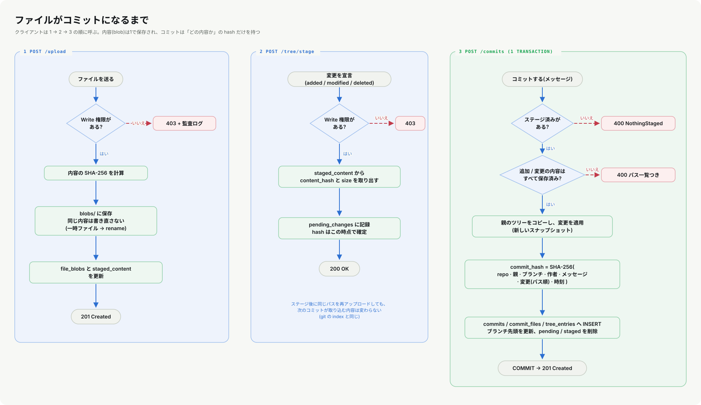
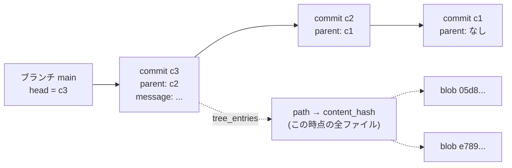

# 05. 内容アドレス方式の VCS: ハッシュ・重複排除・コミットの作り方

**この章で分かること**: このシステムの VCS の**心臓部**です。ハッシュとは何か、なぜ「内容のハッシュを住所にする」と重複排除できるか、コミットがどう作られ、ブランチが何であるか。実際に DB とファイルから、ハッシュを**自分の手で再計算**します。

前提: [04](04-sql-and-storage.md)(表と主キー)。

## 5.1 ハッシュ関数: 内容の「指紋」

ハッシュ関数は、どんな長さのデータからも、**固定長の指紋**(SHA-256 なら 256 ビット = 16進で64文字)を作ります。

```python
import hashlib
hashlib.sha256(b"hello world\n").hexdigest()    # a948904f2f0f479b...
hashlib.sha256(b"hello world!\n").hexdigest()   # ecf701f727d9e2d7...
```

大切な性質は3つです。

| 性質 | 意味 | VCS で効く所 |
|---|---|---|
| **決定的** | 同じ入力なら、いつでも同じ出力 | 同じ内容は同じ住所になる |
| **雪崩効果** | 入力が1文字変わると、出力はまるで別物(上の2つは 256 ビット中 126 ビットが違う) | 少しの改変も見逃さない |
| **衝突しにくい** | 違う入力が同じ出力になることは、現実には起きない | 指紋=内容、と見なせる |

> **ハッシュは暗号化ではない。** 元のデータには戻せません(一方向)。「同じかどうか」を確かめる道具です。

## 5.2 内容アドレス方式: 内容の指紋が、住所になる

ふつうのファイル保存は「名前(パス)」で場所を決めます。**内容アドレス方式**は、**内容のハッシュ**で場所を決めます。

```
blobs/{repo_slug}/{ハッシュの先頭2文字}/{ハッシュ全体}
blobs/audio-master/05/05d8cfe2a52bd3e7c65e805be160e50ef3f5520fd4155ae34f32488691d044fd
```

実際にファイルを検算できます(`lorehub-api` を `cargo run` した場所で)。

```python
import hashlib, os, glob
files = [f for f in glob.glob("blobs/*/*/*") if ".tmp-" not in f]
ok = sum(hashlib.sha256(open(f, "rb").read()).hexdigest() == os.path.basename(f) for f in files)
print(ok, "/", len(files))        # 全部一致する(手元では 84 / 84)
```

**ファイル名そのものが「中身の証明」**になっています。

### これで何が嬉しいか

1. **重複排除**: 同じ内容を何回アップロードしても、住所は同じなので**1つしか保存されない**。巨大なバイナリ(音声・3D)で効く。
2. **壊れの検出**: ファイル名とハッシュが合わなければ、壊れている(または改ざんされている)。
3. **履歴の保持**: 内容は上書きされない。新しい内容は新しい住所に入るので、**古い版が自然に残る**。
4. **コミットが小さい**: コミットは内容そのものでなく、**ハッシュ(参照)**だけを持つ。

### 先頭2文字のフォルダは、なぜ?

1つのフォルダに何十万ファイルを置くと、ファイルシステムが遅くなります。ハッシュの先頭2文字(16進で 00〜ff の **256通り**)でフォルダを分けて、1フォルダの量を 1/256 にしています([`blob_store.rs`](../../lorehub-api/src/blob_store.rs) の `blob_path`)。

### リポジトリごとに分ける(重要な注意)

`file_blobs` の主キーは `(repo_slug, content_hash)` で、保存先も `blobs/{repo_slug}/...` です。つまり重複排除が効くのは**同じリポジトリの中だけ**です。別のリポジトリに同じファイルを入れると、**もう1つ保存されます**(デモデータで実際に起きている)。リポジトリを消したときに、そのリポジトリのブロブだけを確実に消せる、という利点と引き換えです。

## 5.3 ブロブを安全に書く: 一時ファイル → 名前変更

[`blob_store.rs`](../../lorehub-api/src/blob_store.rs) の `save_blob` は、こう書きます。

```
1. すでにそのパスにファイルがあれば、何もしない(内容が同じと分かっている)
2. 同じフォルダに「{ハッシュ}.tmp-{乱数}」という一時ファイルを書く
3. 一時ファイルを、本来の名前へ rename(名前変更)する
```

**なぜ直接書かないのか**: 書き込みの途中でプロセスが落ちると、**途中までのファイル**が本来の名前で残り、「ハッシュと中身が合わない」壊れたブロブになります。`rename` は(同じフォルダなら)**一瞬で、全部かゼロか**です。だから、読む側は「ある」なら必ず完全な内容を読めます。

もう1つ、`save_blob` は書き込みに失敗(`NotFound`)したとき**最大3回やり直し**ます。リポジトリの削除が、書き込み中のフォルダごと消すことがあり得るためです。「競合を完全に防ぐ」より、「やり直す」ほうが簡単で堅牢だと判断された箇所です。

## 5.4 コミット: 「どのファイルがどの内容か」の記録



コミットは**内容を持ちません**。持つのは次の情報です。



- `commits`: 作者・メッセージ・時刻・**親コミットのハッシュ(1つだけ)**。
- `commit_files`: そのコミットで**変わった**ファイル(追加/変更/削除)と、その内容のハッシュ。
- `tree_entries`: そのコミット時点の**全ファイル**の「パス → 内容のハッシュ」(スナップショット)。

### 「単一の親」という割り切り

親は常に**1つ**です。Git の「マージコミット(親が2つ)」や、リベース、コンフリクト解決は**扱いません**。大きなバイナリは自動マージできないので、ロック(排他)で運用する Perforce や Plastic SCM の考え方に近い、意図した割り切りです。

### ブランチは「名前のついた矢印」

```sql
SELECT name, head_commit_hash, is_default FROM branches WHERE repo_slug = 'audio-master';
```

ブランチの実体は、**どのコミットを指すか**(`head_commit_hash`)だけです。コミットすると、そのブランチの `head` が新しいコミットに進みます。履歴の本体は `commits` 側にあります。ブランチを作る・切り替えるのは、**ポインタを1つ書くだけ**なので一瞬です。

### スナップショット方式の損得

`tree_entries` は、**コミットごとに全ファイルの行を持ちます**(デモデータでは、`audio-master` の7コミットで50行、参照する実体は14個)。

| | スナップショット(このシステム) | 差分だけ持つ方式 |
|---|---|---|
| 任意のコミットのツリーを取る | **1回の SELECT**で済む | 親をたどって差分を積み重ねる |
| 行数 | ファイル数 × コミット数 に比例して**増える** | 変更分だけ |
| 実体(ブロブ) | どちらも重複排除される | 同じ |

行は軽い(パスとハッシュだけ)ので、「読みの速さ・単純さ」を選んでいます。数百万ファイル規模になれば、見直す所です。

### 作業中の状態: ステージとツリーの重ね合わせ

`GET /tree` は、**今のブランチの先頭のツリー**に、**ステージ済みの変更**を重ねて返します(`vcs_store.rs` の `resolve_current_files`)。

```
今のツリー(head のスナップショット)
  + pending_changes の added/modified を上書き  (内容がアップロード済みのものだけ)
  - pending_changes の deleted を取り除く
= 画面に出るツリー
```

だから、ステージしただけで(まだコミットしていなくても)ツリーに現れます。

### ステージ時に「内容のハッシュ」を確定する

ステージの瞬間に、そのパスの**その時点の内容**のハッシュを `pending_changes` に書き込みます。その後、同じパスに別の内容をアップロードしても、**次のコミットは、ステージした時の内容**を取り込みます(Git の index と同じ)。「ステージした後に勝手に中身が変わる」事故を防ぐ決めごとです。

## 5.5 コミットのハッシュは、どう決まるか

コミット自身にも、ハッシュ(識別子)があります。[`vcs_store.rs`](../../lorehub-api/src/vcs_store.rs) の `compute_commit_hash` は、次の文字列の SHA-256 です。

```
{repo_slug}\n
{親のハッシュ。無ければ空}\n
{ブランチ名}\n
{作者のメール}\n
{メッセージ}\n
{説明。無ければ空}\n
{パス}\x1f{変更の種類}\x1f{内容のハッシュ}\n      ← 変更されたファイルごと。パスの昇順
...
{作成時刻(Unix秒)}
```

### 演習: DB の行から、自分で再計算する

```python
import sqlite3, hashlib
db = sqlite3.connect("lorehub-api/lorehub.db"); db.row_factory = sqlite3.Row

def recompute(repo, commit_hash):
    c = db.execute("SELECT * FROM commits WHERE repo_slug=? AND hash=?", (repo, commit_hash)).fetchone()
    files = sorted(
        db.execute("SELECT path, change_type, content_hash FROM commit_files "
                   "WHERE repo_slug=? AND commit_hash=?", (repo, commit_hash)).fetchall(),
        key=lambda r: r["path"])
    US = "\x1f"
    buf = "\n".join([c["repo_slug"], c["parent_hash"] or "", c["branch_name"],
                     c["author_email"], c["message"], c["description"] or ""]) + "\n"
    for f in files:
        buf += f["path"] + US + f["change_type"] + US + (f["content_hash"] or "") + "\n"
    buf += str(c["created_at"])
    return hashlib.sha256(buf.encode("utf-8")).hexdigest()

rows = db.execute("SELECT repo_slug, hash FROM commits").fetchall()
print(sum(recompute(r["repo_slug"], r["hash"]) == r["hash"] for r in rows), "/", len(rows))
```

手元の実行では **42 / 42**(全コミットが一致)でした。コミットのハッシュは「どこかの乱数」ではなく、**内容から計算できる値**だ、と確かめられます。

### なぜ区切りに `\x1f` を使うのか

文字列を**ただ連結**すると、区別できない別物ができます。

```python
hashlib.sha256(b"ab" + b"c") == hashlib.sha256(b"a" + b"bc")      # True  ← 同じ!(危険)
hashlib.sha256(b"ab\x1fc")   == hashlib.sha256(b"a\x1fbc")        # False ← 区切りで区別できる
```

`\x1f`(ASCII の「単位区切り」)は、ふつうのファイル名やメッセージに現れないので、「つなぎ目」を曖昧にしません。**ハッシュに入れる情報を並べるときは、必ず曖昧さのない区切りを使う**、が鉄則です。

### なぜパスを昇順に並べるのか

ステージした**順序**でハッシュが変わると、同じ変更なのに違うコミット ID になります。ハッシュに入れる前に**並び順を決める**(正規化する)ことで、順序に依存しなくなります。

## 5.6 設計上の注意(知っておくべき癖)

- **「現在のブランチ」はリポジトリごとにサーバーに1つ。** `current_branch` 表は `repo_slug` が主キーです。誰かが `checkout` すると、**全員の `GET /tree` が変わります**。個人ごとの作業コピーという考え方が、まだありません(読みの設計は、そのまま残している既知の癖)。
- 行が無ければ `main` として扱う(`get_current_branch`)。デフォルトブランチ名が `main` でないリポジトリでは、これは正しくありません。
- 同時に2人がコミットしても、**同じ `pending_changes` 表を共有**しています(ステージはユーザーごとでなくリポジトリごと)。

## 5.7 まとめ

- ハッシュは内容の指紋。決定的・雪崩効果・衝突しにくい。暗号化ではない。
- 内容アドレス方式 = 内容のハッシュが住所。重複排除、壊れの検出、履歴の保持が自然にできる。**重複排除はリポジトリの中だけ。**
- 書くときは「一時ファイル → rename」で、途中の壊れを防ぐ。
- コミットは内容でなく**参照(ハッシュ)**を持つ。親は1つ。ブランチは先頭コミットを指す矢印。
- ハッシュに入れる情報は、**曖昧さのない区切り**と**決まった並び順**で。
- ステージ時に内容のハッシュを確定する。

## 5.8 演習

1. `curl` でコミット一覧を取り(`GET /api/repositories/audio-master/commits`)、`hash` と `shortHash` の長さを比べる。Web 画面では先頭何桁を表示しているか?([09章](09-ui-rules.md))
2. ブロブのファイルを**コピーした `blobs/`** で1バイト書き換え、5.2 の検算を実行する。どう検出されるか。(これを「整合性チェック」の API にするなら、どんな応答を返すのがよいか考える。)
3. 5.5 の `recompute` を改造して、**わざと区切りを使わず**に連結し、全コミットで一致しなくなることを確かめる。
4. **設計**: 「同じ内容のブロブを**リポジトリをまたいで**共有する」には、何を変える必要があるか。得るものと失うもの(リポジトリ削除、アクセス制御)を挙げる。
5. **設計**: マージコミット(親が2つ)を許すには、どのテーブルのどこを変える必要があるか。(ヒント: `parent_hash` が1列であること、`buildCommitGraph` の `parents: string[]` が既に配列であること。)

前: [04. SQL と永続化](04-sql-and-storage.md) / 次: [06. 差分アルゴリズム](06-diff-algorithm.md)
