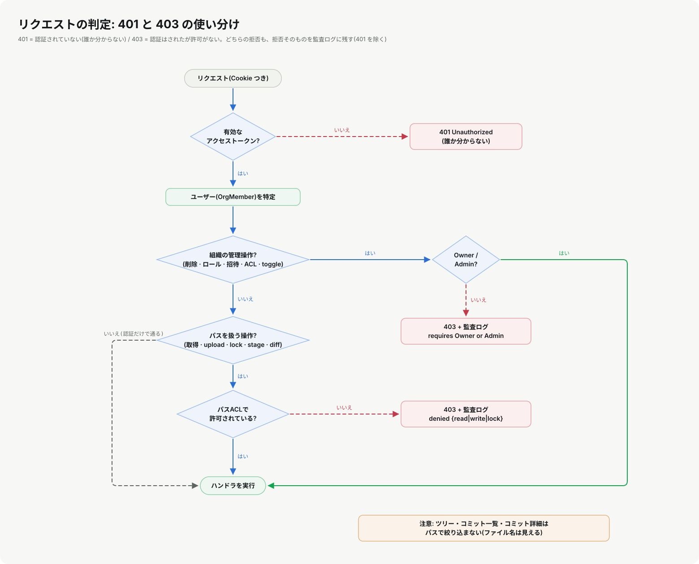

# 07. 認証と認可

**この章で分かること**: 「あなたは誰か」(認証)と「あなたに許されているか」(認可)を、このシステムがどう実装しているか。パスワードの保存、セッションと更新、401 と 403、ロール(RBAC)とパス単位の権限(ACL)の判定アルゴリズム、レート制限。そして、**実際に見つけて直した認可の穴**。

前提: [01](01-web-basics.md)(Cookie とセッション)、[03](03-axum-api.md)(ミドルウェア)。



## 7.1 認証と認可は別の問い

| | 認証(Authentication) | 認可(Authorization) |
|---|---|---|
| 問い | **あなたは誰か** | **あなたは、これをしてよいか** |
| 失敗したら | **401** | **403** |
| このシステムで | ログイン、セッション、`require_auth` | ロール確認、パスACL |

認証が先、認可が後です。認証が通ったことは、何でもしてよいことを意味しません。

## 7.2 パスワードを保存する

パスワードは**そのまま保存してはいけません**。DB が漏れたとき、全員のパスワードが読まれてしまうからです。代わりに**ハッシュ**(一方向の変換)を保存し、ログイン時に「入力をハッシュして、保存したものと合うか」を見ます。

ただし、[05](05-content-addressing.md) の SHA-256 のような「速い」ハッシュは、パスワードには**不向き**です(攻撃者が1秒に何十億回も試せる)。パスワード用には、**わざと遅く、メモリも食う**専用の関数を使います。このシステムは **Argon2** です([`auth.rs`](../../lorehub-api/src/auth.rs))。

```rust
pub fn hash_password(password: &str) -> String {
    let salt = SaltString::generate(&mut OsRng);          // ① 毎回違う乱数(ソルト)
    Argon2::default()                                      // ② Argon2id、既定の強さ
        .hash_password(password.as_bytes(), &salt)
        .expect("...")
        .to_string()                                       // ③ アルゴリズム・強さ・ソルト・ハッシュが1本の文字列に
}
```

- **ソルト**: 同じパスワードでも、毎回違うハッシュになる。「みんなが `lorehub` を使っているか」を、ハッシュの一致から見破れない。
  - **注意(デモデータ)**: 4つのデモアカウントは同じパスワード `lorehub` で、シードは `hash_password("lorehub")` を**1回だけ**計算して全員で共有しています(`state.rs`)。実際に `kv_store` の `credentials` を見ると、**ハッシュは4つ中1種類**です。これは「ソルトが無い(または共有)と、同じパスワードが同じハッシュとして見える」実例です。招待やパスワードリセットで作るアカウントは、`hash_password` を呼ぶたびに別のソルトが付きます。**本番では、デモアカウントを使わない・パスワードを変える**こと。
- **既定の強さ**(使っている `argon2` クレートの既定): メモリ 19 MiB、反復 2 回、並列 1。1回の計算に、目安として数十ミリ秒前後かかる(**意図的に**。環境により変わり、デバッグビルドでは遅い)。
- 保存される文字列(`$argon2id$v=19$m=19456,t=2,p=1$...`)に設定も入っているので、**後から強さを上げても、古いハッシュを検証できる**。

### 「遅い」ことの副作用

「遅い」=「CPU を食う」です。ログインは**認証なしで誰でも叩ける**入口なので、攻撃者に重い計算を何度もさせられる点に注意が要ります。このシステムの対策は2つあります。

1. **レート制限**(7.6)で、送信元ごとの回数を絞る。
2. 重い計算の間、**全体で共有している書き込みロックを持たない**。以前の `login` は、書き込みロックを握ったまま Argon2 を計算していたので、他のすべての要求がその間止まりました。今は「ロックを短く取って、必要な物を取り出す → ロックなしで検証(`spawn_blocking`)→ 短く取って、トークンを登録」の順です([02章](02-rust-basics.md)の `Arc`/`RwLock`)。

> **既知の課題**: `change_password`・`accept_invite`・`reset_password` も、まだ書き込みロックを握ったままハッシュを計算しています。トークンの検証と更新が絡むので、競合を考えながら直す必要があり、今回は手を付けていません(TECHNICAL_REFERENCE.md §7)。

> **もう一つの既知の癖**: 存在しないメールは、ハッシュ計算を**しないで**すぐ 401 を返します。パスワードが違う場合は計算した後に 401 です。**応答時間の差**から、登録済みのメールを推測できる余地があります(応答の中身は同じ 401)。直すには、存在しないメールでもダミーのハッシュを検証します。

## 7.3 セッションと、その更新

[01](01-web-basics.md) のとおり、トークンは乱数の合言葉で、意味はサーバーの表(`sessions`)にあります。

```
ログイン:  アクセストークン(30分)とリフレッシュトークン(7日)を発行し、どちらも表に登録
毎回の要求: Cookie のアクセストークンを表で引く(期限切れなら 401。その場で表からも消す)
更新:       リフレッシュトークンを渡す → 新しい2つを発行、古いリフレッシュは即座に無効(ローテーション)
ログアウト: 両方を表から消す(204)
```

**リフレッシュのローテーション**が大切です。リフレッシュトークンは長生きなので、盗まれたら被害が大きい。使うたびに作り直して古いものを捨てれば、**盗まれたものを後から使っても、すでに無効**になりやすくなります。

> **発展**: 古いリフレッシュが**再利用された**こと自体を「盗難の兆候」と見なして、そのユーザーの全セッションを失効させる方式もあります。このシステムは、そこまでは実装していません。

Web 側の「期限切れを、利用者に気づかせずに更新する」仕組みは [08章](08-nextjs-frontend.md) です。

## 7.4 ロール(RBAC): 組織の運営操作

`MemberRole` は `Owner` / `Admin` / `Member` の3つ。次の**組織の運営操作**は、Owner か Admin だけができます([`handlers.rs`](../../lorehub-api/src/handlers.rs) の `is_owner_or_admin`)。

| 操作 | エンドポイント |
|---|---|
| リポジトリの削除 | `DELETE /api/repositories/{slug}` |
| メンバーのロール変更 | `PATCH /api/org/members/{email}` |
| 権限グラフの一括適用 | `PUT /api/access-control/entries` |
| **権限の1件の切り替え** | `POST /api/access-control/entries/toggle`(**2026-10 から**) |
| 招待の作成・一覧・取り消し | `POST/GET /api/org/invites`, `DELETE /api/org/invites/{email}` |

拒否したときは、**403 を返し、監査ログに記録**します(`deny_role_action`)。

## 7.5 パスACL: 「どのファイルを触れるか」

`access_entries` は「パス → 権限を持つ主体(ユーザーまたはチーム)と、その権限(`read` / `write` / `lock`)のリスト」です。ファイルを読む・書く・ロックするハンドラは、`check_path_permission`([`authz.rs`](../../lorehub-api/src/authz.rs))を呼びます。

### アルゴリズム

```
check_path_permission(user, path, 必要な権限):
  1. user が Owner か Admin なら、許可
  2. path と、その祖先を「いちばん具体的な順」に並べる
       "Assets/Characters/hero.fbx"  →  [ "Assets/Characters/hero.fbx", "Assets/Characters", "Assets" ]
  3. その順に見て、「エントリが1件以上ある」最初の祖先で判定を確定する
       ・user(名前)か user のチームのどれかが一致し、必要な権限を持っていれば 許可
       ・それ以外は 拒否    (※より上位の祖先は、もう見ない)
  4. どの祖先にもエントリが無ければ、許可(既定で許可)
```

要点は2つです。**「最初に見つかった祖先が勝つ」**(より具体的な設定が、上位の設定を完全に置き換える)ことと、**「何も設定されていなければ許可」**であること。

### 真理値表(デモデータ、`QA Contractors` チームの一般メンバー=Diego の場合)

デモデータの設定は次のとおりです(抜粋)。

| パス | 設定されている主体と権限 |
|---|---|
| `Assets` | Environment Artists・Character Artists = read,write / **QA Contractors = read** |
| `Assets/Characters` | Character Artists・Aiko Tanaka = read,write,lock |
| `Source` | Engineering ほか |

実際に Diego で API を叩いた結果(実行して確かめた値)です。

| 操作 | パス | 結果 | 理由 |
|---|---|---|---|
| 読む | `Assets/Characters/x.txt` | **403** | 最初に設定を持つ祖先は `Assets/Characters`。QA はそこに**いない**。`Assets` が QA に read を許していても、**上位は見ない** |
| 読む | `Assets/Props/x.txt` | 404(許可。ファイルが無いだけ) | 最初の祖先は `Assets`。QA は read を持つ |
| 書く | `Assets/Props/x.txt` | **403** | `Assets` で QA は read だけ |
| 読む | `Docs/x.txt` | 404(許可) | どの祖先にも設定が無い → 既定で許可 |
| **書く** | `Docs/x.txt` | **201(書けてしまう)** | 同じ理由。**設定が無いパスは、誰でも書ける** |
| 読む(Cookie なし) | `Docs/x.txt` | **401** | 認証の段階で止まる |
| 切り替え | `/access-control/entries/toggle` | **403** | 管理操作(Member は不可) |
| 削除 | `DELETE /api/repositories/…` | **403** | 管理操作 |

> **この表の読み方**: 上から3行目までで「最も具体的な設定が勝つ」を、**5行目**で「何も設定が無いと許可」の意味を確認できます。5行目は便利ですが、**「設定し忘れたパスは無防備」**でもあります。この既定(fail-open)は、機能を足す前の「全部公開」の挙動を壊さないための**互換性の選択**です。新しい重要なパスには、設定を入れる運用が必要です。

> **細部**: エントリの配列が**空**の祖先は「設定されている」と数えず、さらに上へ進みます(`entries.is_empty()` なら `continue`)。

### 判定する場所

| 権限 | 使うハンドラ |
|---|---|
| **read** | ファイル内容・画像・音声・diff の取得 |
| **write** | アップロード、ステージ |
| **lock** | ロックの切り替え |

コミット作成(`create_commit`)には、判定がありません。**ステージの時点で write を確認済み**だからです。

## 7.6 レート制限: 総当たりを遅くする

ログイン(と、パスワードを忘れた時のメール送信)は、送信元 IP ごとに回数を絞ります(`tower_governor`)。方式は**トークンバケット**の系統です。

```
バケツには最大 8 個のトークン(バースト)。1回の要求でトークンを1個使う。
トークンは 60 秒に 1 個ずつ補充される(ただし 8 個まで)。トークンが無ければ 429。
```

```python
class TokenBucket:
    def __init__(self, burst, seconds_per_token):
        self.burst, self.rate = burst, 1 / seconds_per_token
        self.tokens, self.last = float(burst), 0.0           # 最初は満タン

    def allow(self, now):
        self.tokens = min(self.burst, self.tokens + (now - self.last) * self.rate)   # 経過時間ぶん補充
        self.last = now
        if self.tokens >= 1:
            self.tokens -= 1
            return True
        return False
```

```
b = TokenBucket(burst=8, seconds_per_token=60)
t=0 に 10 回:   ok ok ok ok ok ok ok ok 429 429     ← 最初の8回は通り、9回目から止まる
t=30 秒:        429                                 ← まだ補充が1個に満たない
t=60 秒:        ok                                  ← 1個補充された
t=61 秒:        429
1時間、5秒ごとに試し続ける:  通るのは 67 回           ← 8 + (約60分 = 約59〜60個)
```

つまり、攻撃者が**長く試し続けても、1分に約1回**しか試せません。普通の利用者は、数回間違えても止まりません。

**IP 単位であって、メール単位ではない**ことに注意。メールアドレス単位で制限すると、攻撃者が**他人のアドレスで失敗を重ねて、本人を締め出せて**しまいます。代わりに、複数の送信元から分散して攻撃する手には弱い(別の対策が要る)ことを、受け入れた設計です。

## 7.7 他の防御(まとめ)

| 対策 | 防ぐもの | 場所 |
|---|---|---|
| リクエスト本文の上限(48 MiB、超過で 413) | 巨大な本文でメモリを枯らす | `RequestBodyLimitLayer` |
| diff のファイルサイズ上限(5 MiB) | 重い計算 | `get_diff` |
| CORS(単一オリジン) | 他サイトのページからの越境呼び出し | `CorsLayer` |
| `HttpOnly` / `SameSite` / `Secure` Cookie | トークンの窃取、他サイトからの勝手な送信 | `auth.rs` |
| 監査ログ(拒否も記録) | 不正の検知・追跡 | `record_audit` |
| 認可は**サーバー側**で行う | クライアントの画面を迂回した呼び出し | すべてのハンドラ |

最後の行が根本です。画面でボタンを隠しても、**API は誰でも直接叩けます**。守るのは、いつも API 側です。

## 7.8 実例: 見つけた穴と、見つけ方

**穴**: `POST /api/access-control/entries/toggle` にロール確認が無く、一般メンバーが**自分に好きな権限を付けられました**。同じ表を書き換える `PUT`(一括適用)は管理者限定だったのに、です。

**見つけ方**: 全ハンドラについて「どのガードを通るか」を**機械的に**一覧にしました(各関数の本文に `check_path_permission` や `is_owner_or_admin` があるかを数える小さなスクリプト)。表([TECHNICAL_REFERENCE.md §4.3](../TECHNICAL_REFERENCE.md))にすると、`PUT` と `toggle` の非対称が一目で分かりました。

**直し方**: ①まず**失敗するテスト**(Member が toggle して 403 になるはず)を書き、「200 が返る」ことで穴の実在を確認 → ②ガードを1つ足す → ③テストが通り、**拒否が監査ログに残る**ことも確認。さらに、ビルドし直した実際のサーバーでも 403(Member)/200(Admin)を確かめました。

> **落とし穴の落とし穴**: 最初の実機確認で 200 が返りました。原因は、**直す前にビルドした古い実行ファイル**を起動していたことでした(`cargo test` は、通常のバイナリを作り直しません)。「テストが通った」と「実際に動くものが直った」は別です。**直した後は、動かすものをビルドし直して確かめる。**

OWASP の「API セキュリティ Top 10」に当てると、これは **BFLA(機能レベルの認可の不備)**です。同じ表を変える入口が複数あるとき、**片方だけ守る**ことで起きます。

**まだ決めていない項目**(意図かもしれないので、変えずに記録してあります): リポジトリ設定の更新(公開範囲も変えられる)、ACL で絞られないツリー一覧、全員が読める監査ログ。判断は仕様の持ち主に返します。

## 7.9 まとめ

- 認証=誰か(401)、認可=してよいか(403)。混ぜない。
- パスワードは**ソルトつきの遅いハッシュ**(Argon2)で保存。重い計算の間は共有ロックを持たない。
- セッションは乱数+サーバーの表。リフレッシュは使うたびに作り直す。
- ロール(運営操作)とパスACL(ファイル操作)は**別の層**。パスACLは「最も具体的な祖先が勝つ・無ければ許可」。
- レート制限はトークンバケット。IP 単位。
- 認可はサーバーで。**同じデータを変える入口は、全部同じ強さで守る。**

## 7.10 演習

1. 7.5 の真理値表の「読む `Assets/Characters/x.txt`」が 403 になる理由を、アルゴリズムの手順番号で説明する。`Assets` で QA に read があるのに、なぜ通らないのか?
2. `src/tests/authz.rs` を読み、「最も具体的な祖先が勝つ」を確かめているテストを探す。自分で「`Assets/Characters/hero.fbx` に、さらに個別の設定を足したら?」というテストを書く。
3. 7.6 の `TokenBucket` を `burst=3, seconds_per_token=10` で動かし、`t=0,1,2,3,10,20` の結果を予想してから、実行して確かめる。
4. **設計**: 「設定が無いパスは**拒否**する」(fail-closed)に変えると、何が壊れるか。どの画面・テストが影響を受けるか。移行の手順を考える。
5. **改善**: 存在しないメールでも応答時間が変わらないように、`login` を直す方針を書く。(ヒント: 起動時に**ダミーのハッシュ**を1つ用意し、メールが無いときも、そのダミーに対して `verify_password` を実行してから 401 を返す。)
6. **確かめる**: `kv_store` の `credentials` を読み、デモアカウントのハッシュが何種類あるかを数える(4つ中1種類のはず)。なぜそうなるかを `state.rs` で確かめる。招待を承諾して作ったアカウントのハッシュは、これと同じになるか?
7. **調査**: `change_password` がロックを握ったままハッシュを計算している。`login` と同じ形に直すとき、**競合の危険**(確認と更新の間に状態が変わる)は何か?

前: [06. 差分アルゴリズム](06-diff-algorithm.md) / 次: [08. Next.js のフロントエンド](08-nextjs-frontend.md)
