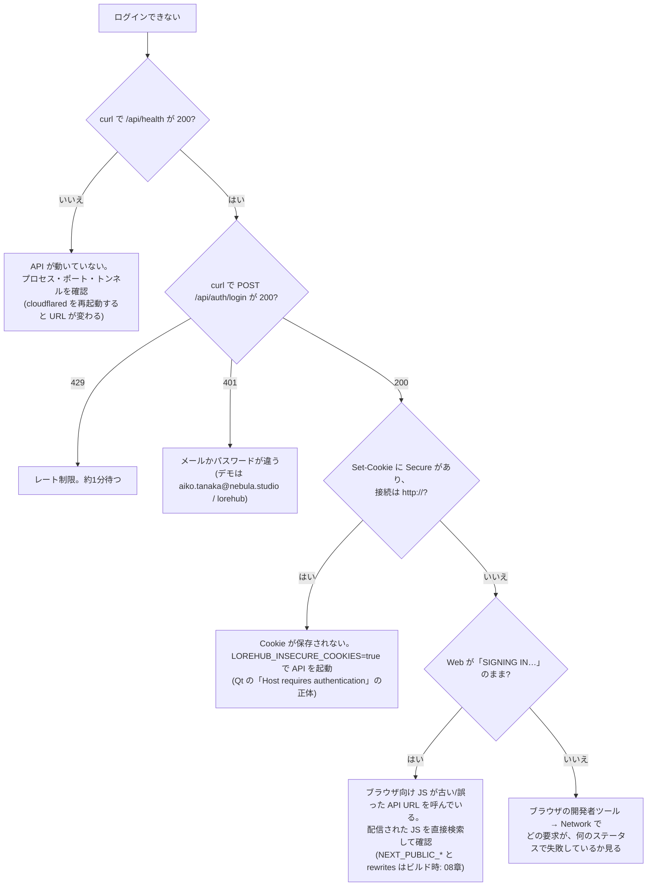

# 13. 拡張レシピ集

**この章で分かること**: 「こうしたいとき、どこを、どの順で触るか」を手順にしました。各レシピは、**実際にその手順どおりに実行して確かめた**ものです(確かめ方も書いてあります)。最後に、困ったときの決定木、コミット前のチェックリスト、次に取り組むと良い課題のリストがあります。

前提: 01〜11章のうち、触る部分の章。

## 13.1 何を足すとき、どこを触るか

| やりたいこと | 触る場所 | レシピ |
|---|---|---|
| 新しい API を足す | `handlers.rs`、`main.rs`(ルート)、`tests/`、ガード表 | A |
| 既存の JSON に項目を足す | `models.rs`、`vcs_store.rs` など、`lib/types.ts`、テスト | B |
| DB に表・列を足す | `migrations/` に**新しい**ファイル、テスト | C |
| ファイルの種類・拡張子 | `vcs_store.rs` **と** `icons.tsx`(2か所) | D |
| 色・角丸・余白 | `design-tokens/tokens.json` → 再生成 | E |
| 新しい UI 部品 | `components/`、`lib/`、テスト | F |
| 図を足す・直す | `tools/diagrams/specs/` → 再生成 | G |

**共通の流れ**: ①**失敗するテスト**を先に書く(または、再現する)→ ②直す・足す → ③テストが通る → ④**動かして確かめる**(ビルドし直す)→ ⑤文書を更新 → ⑥チェックリストで確認してコミット。

## 13.2 レシピ A: 新しい API エンドポイントを足す

例: `GET /api/ping` が `{ "pong": true }` を返す(ログイン必須)。

**① ハンドラ**を [`handlers.rs`](../../lorehub-api/src/handlers.rs) に書く。

```rust
/// `GET /api/ping` — a minimal authenticated endpoint.
pub async fn ping() -> Json<serde_json::Value> {
    Json(serde_json::json!({ "pong": true }))
}
```

**② ルート**を [`main.rs`](../../lorehub-api/src/main.rs) の `build_router` の **`protected_routes`** に足す。

```rust
let protected_routes = Router::new()
    .route("/api/ping", get(handlers::ping))        // ← 足す
    .route("/api/auth/logout", post(handlers::logout))
    /* ... */
```

> **公開にしない。** `protected_routes` に足せば、`require_auth` が自動でかかる(ログイン必須)。`public_routes` に足すのは、**ログイン前に使える**と決めたものだけ([03章](03-axum-api.md))。

**③ テスト**を `src/tests/ping.rs` に書き、`src/tests/mod.rs` に `mod ping;` を足す。

```rust
use axum::http::StatusCode;
use super::{DEMO_EMAIL, body_json, login_cookie, plain_request, send, test_app};

#[tokio::test]
async fn ping_requires_login_and_returns_pong() {
    let app = test_app().await;

    let anonymous = send(&app, plain_request("GET", "/api/ping", None)).await;
    assert_eq!(anonymous.status(), StatusCode::UNAUTHORIZED);          // ログインしていなければ 401

    let cookie = login_cookie(&app, DEMO_EMAIL).await;
    let resp = send(&app, plain_request("GET", "/api/ping", Some(&cookie))).await;
    assert_eq!(resp.status(), StatusCode::OK);
    assert_eq!(body_json(resp).await["pong"], true);
}
```

**④ 確かめる**: `cargo test ping`、そして全体の `cargo test`、`cargo clippy --all-targets -- -D warnings`、`cargo fmt`。

> **実際に試した結果**: 使い捨てのコピーにこの変更を足して `cargo test` を走らせ、**既存の123件に新しい1件が加わって通る**ことを確かめました。

### データを変えるエンドポイントを足すとき(必ず)

**認可のガード**を付けます(**同じデータを変える入口は、全部同じ強さで守る** — [07章](07-auth-and-authz.md))。

| 何をするか | 付けるガード | 書き方 |
|---|---|---|
| 組織の運営操作(削除・ロール・招待・ACL) | Owner/Admin | `if !is_owner_or_admin(&user) { return deny_role_action(&ctx, &user, "…", &対象).await; }` |
| パス(ファイル)の読み・書き・ロック | パスACL | `check_path_permission(&state, &user, &slug, &path, PermissionLevel::Write)`。拒否は `deny_path_access` |

そして**拒否のテスト**を、一般メンバー(例: `src/tests/authz.rs` が定義している `QA_CONTRACTOR_EMAIL` = `diego.fernandez@nebula.studio`)で書きます。`src/tests/authz.rs` の `toggle_permission_requires_admin_or_owner` が見本です。確かめることは3つ: ①**403** ②拒否の後に**データが変わっていない** ③拒否が**監査ログに残る**。最後に、[TECHNICAL_REFERENCE.md §4.3 のガード表](../TECHNICAL_REFERENCE.md)に**行を足します**(表が古くなると、穴の発見に使えなくなる)。

### Web から呼ぶ

`lorehub-web/src/lib/api.ts` に、`apiGet` / `apiSend` を使う関数を足し、型を `lib/types.ts` に書きます。書き込みなら、画面側で**失敗を受け止める**(`try/catch` + `mutationErrorMessage` + トースト。レシピ F)。

## 13.3 レシピ B: 既存の JSON に項目を足す

例(実際にやったこと): コミットに `createdAt`(Unix秒)を足す。

1. **`models.rs`** の構造体に項目を足す。**`#[serde(default)]`** を付ける(古い JSON を読んでも壊れない)。

   ```rust
   #[serde(default)]
   pub created_at: i64,
   ```

2. **コンパイラが、直す場所を教えてくれる。** 構造体を作っている全ての場所が「項目が足りない」とエラーになる。`cargo build` を回して、1つずつ値を入れる(`vcs_store.rs` の2か所だった)。**これは、型のある言語の恩恵。**
3. **Web の型**(`lib/types.ts`)に足す。画面で使うなら、表示部品も(`RelativeTime`)。
4. **テスト**: 実際に値が入ることを確かめる(`0` のままの手抜きを、テストが見つける)。
5. **Qt** は、知らない項目を**無視する**ので、足すだけなら変更不要(`QJsonObject::value("…")` で読むものだけを読むため)。

> **足すのは互換、変える・消すのは破壊的。** 既存の項目の名前・型を変える、消すと、Web と Qt の**両方**が壊れます。足すだけにして、古い項目は残す。

## 13.4 レシピ C: DB に表・列を足す(マイグレーション)

例: コミットに「タグ」を付ける表。

1. `lorehub-api/migrations/` に、**次の番号の新しいファイル**を作る(`0002_tags.sql`)。**`0000`・`0001` は編集しない**([04章](04-sql-and-storage.md))。

   ```sql
   CREATE TABLE tags (
       repo_slug   TEXT NOT NULL REFERENCES repositories(slug) ON DELETE CASCADE,
       name        TEXT NOT NULL,
       commit_hash TEXT NOT NULL,
       PRIMARY KEY (repo_slug, name),
       FOREIGN KEY (repo_slug, commit_hash) REFERENCES commits(repo_slug, hash) ON DELETE CASCADE
   );
   ```

2. 表ができたことを確かめるテストを書く(`test_pool()` で、メモリ DB に**全マイグレーションが適用された**状態を得られる)。

   ```rust
   let pool = test_pool().await;
   let row = sqlx::query("SELECT name FROM sqlite_master WHERE type = 'table' AND name = 'tags'")
       .fetch_optional(&pool).await.expect("query");
   assert!(row.is_some());
   ```

3. `cargo test`(マイグレーションは**コンパイル時に**埋め込まれる。ファイルを足したら、ビルドし直す)。
4. 読み書きの関数を、`repo_store.rs` / `vcs_store.rs` のような**専用のファイル**に書く(ハンドラに SQL を直接書かない)。
5. **`ON DELETE CASCADE` と `PRAGMA foreign_keys`** を忘れない。リポジトリを消したとき、新しい表の行が**残らない**ことを、テストで確かめる(`tests/vcs.rs` の `deleting_repository_cascades_all_vcs_tables_to_zero_rows` が見本。新しい表を、確かめる対象に足す)。

> **実際に試した結果**: 使い捨てのコピーに `0002_tags.sql` とテストを足して全体を走らせると、**既存のテストは1つも壊れず**、`_sqlx_migrations` に成功した3行が記録されました(`0000`、`0001`、`0002`)。

**やってはいけない**: 適用済みの `0001` に列を足す。チェックサムが変わり、**既存の DB で起動に失敗**する。

## 13.5 レシピ D: ファイルの種類・拡張子を足す

**同じ知識が2か所にあります**。

| 場所 | 何を決めているか | 使い道 |
|---|---|---|
| [`vcs_store.rs`](../../lorehub-api/src/vcs_store.rs) の `file_kind_for_path` | 拡張子 → `text`/`image`/`model3d`/`audio`/`binary` | **挙動**を決める(プレビュー、diff の対象、容量の集計) |
| [`icons.tsx`](../../lorehub-web/src/components/icons.tsx) の `inferFileKind` | 同じ対応(Web 側の独自の表) | コミット詳細などの**アイコン** |

**すでにずれています**(確認した事実)。

| 拡張子 | API(Rust) | Web(アイコン) |
|---|---|---|
| `svg` | image | (表に無い → binary のアイコン) |
| `tga`, `exr` | binary | image |
| `blend`, `usd` | binary | model3d |
| `flac` | binary | audio |
| `txt` | text | (表に無い → binary のアイコン) |
| `ts`, `tsx`, `js`, `jsx`, `py` | binary | text |

(`text` と `binary` は同じアイコンなので、見た目に出るのは、画像・3D・音声の行だけです。)

**既存の種類に拡張子を足す**(例: `.usd` を 3D モデルに): **両方**の表に足す。Rust は `"fbx" | "obj" | ...` の並びへ、Web は `MODEL_EXTENSIONS` へ。**片方だけだと、また、ずれる。**

**新しい種類を足す**(例: `video`)は、大きな変更です。

- `tree_entries.file_kind` の `CHECK (file_kind IN (...))` に新しい種類を足す必要がある。**SQLite は制約を後から変えられない**ので、表を作り直すマイグレーション(新しい表を作る → 行を写す → 古い表を消す → 名前を変える)になる。
- `FileKind`(`lib/types.ts`)、`FILE_KIND_ICON`、`BUCKET_OF_KIND`(`lib/format.ts`)に足す。**`Record<FileKind, …>` なので、足し忘れると TypeScript がコンパイルエラーにする**(型が、見落としを防ぐ)。
- Qt の `kind` 文字列を使っている所(`RepositoryWorkspaceScreen.qml` の `kindLabel` など)。

> **根本の直し方**(演習): API が、コミットの各変更ファイルに `fileKind` を**返す**ようにして、Web は自分で推測せず、**API の答えを使う**。知識を**1か所**にする(2か所に書くから、ずれる)。

## 13.6 レシピ E: デザイントークンを足す・変える

**実際に試した結果**: `tokens.json` に `--color-info-subtle` を足すと、`gen-tokens --check` が**3つの生成物を「古い」と報告して終了コード1**になり、`gen-tokens` を実行すると、CSS と両方の `Theme.qml` に**同じ値**が出ました。試した後は、`git checkout` で元に戻しました。

手順:

1. **`design-tokens/tokens.json` を編集**する。1つのトークンは `{ "css": "--color-…", "qml": "color…", "value": "#…" }`。**手で1行足す**(JSON を別のツールで整形し直すと、全行が書き換わって差分が読めなくなる)。
2. `node tools/gen-tokens.mjs` → 3つの生成物が書き換わる。
3. `node tools/gen-tokens.mjs --check` → 通る。
4. **配色を変えたときは、コントラスト比を計算し直す**([09章](09-ui-rules.md))。
5. Web で使うには、`globals.css` の `@theme inline` に `--color-info-subtle: var(--color-info-subtle);` を足す(Tailwind のクラス `bg-info-subtle` が使える)。
6. Qt を変えたら、**両アプリをビルド**してテスト([12章](12-qt-qml.md))。
7. `tokens.json` と生成物を**同じコミット**に入れる。

## 13.7 レシピ F: 新しい UI 部品(と、失敗の経路)

[09章 9.4](09-ui-rules.md) の型に従います。書き込みを伴う部品の**型**:

```tsx
const handleSubmit = async () => {
  setSubmitting(true);
  try {
    const updated = await somethingThatWrites(/* ... */);
    if (updated) setState(updated);
  } catch (error) {
    showToast(mutationErrorMessage(error, "You do not have permission to do this."));   // 理由を言う
  } finally {
    setSubmitting(false);                  // 成功しても失敗しても、必ず戻す(固まるボタンを作らない)
  }
};
```

- 失敗の文言は `mutationErrorMessage`(403 なら呼び出し側の説明、それ以外は一般的な文)。
- **ロジックは `lib/` に出して、テストを書く**(サーバーコンポーネントは単体テストしにくい)。
- 色だけに頼らない・読み上げ・キーボード([09章](09-ui-rules.md))。

## 13.8 レシピ G: 図を足す・直す

**実際に試した結果**: 2つのノードをわざと重ねた仕様で `node tools/diagrams/build.mjs` を走らせると、**描かずに「nodes "a" and "b" overlap」というエラー(終了コード1)**で止まりました。直すと、`docs/diagrams/zz-demo.svg` が生成されました。試した後は、仕様も SVG も削除しました。

1. `tools/diagrams/specs/` に `名前.mjs` を作る(**ファイル名と、仕様の `name` を同じに**。違うとエラー)。既存の仕様をコピーして直すのが早い。
2. 仕様のキー: `width` / `height`、`groups`(枠)、`nodes`(`id`・`x`・`y`・`icon`・`label`・`caption`・`tone`)、`edges`(`from`・`to`・`label`・`step`・`dashed`・`via`)、`labels`(自由な文字)。**座標はノードの中心**。折れ線は `via` の点を、ノードの中心と x か y を揃えて置くと、直角になる。
3. `node tools/diagrams/build.mjs` → `docs/diagrams/名前.svg` ができる。
4. **画像にして見る**(SVG を、ブラウザや画像ビューアで開く)。矢印が文字を横切る・ラベルが隠れる・注記が重なる、は**検証では見つからない**ので、目で見る。
5. HTML 資料へ入れるなら、`docs/lore-ecosystem-docs.html` の入れたい場所に、**目印**を書く。

   ```html
   <div class="card diagram-card">
   <!-- diagram:名前 -->
   <!-- /diagram:名前 -->
   </div>
   ```

   再度 `build.mjs` を走らせると、2つの目印の**間だけ**が置き換わる(周りの文章は触らない)。
6. Markdown からは `` で参照する。
7. アイコンを足したいときは `icons.mjs` に 32×32 の線画を足す(`stroke` だけ)。

## 13.9 ログインできないとき



**調べ方の原則**: ①**一番手前**(API 単体を `curl`)から確かめる。②画面の表示や、ダッシュボードの設定を**信じず**、実際に配信された物・実際の応答を見る。③「何が起きたか」を、**エラー文言の出所**まで辿る。

## 13.10 コミット前のチェックリスト

```bash
# 生成物が、元と一致している
node tools/gen-tokens.mjs --check && node tools/diagrams/build.mjs --check

# API
cd lorehub-api && cargo fmt && cargo clippy --all-targets -- -D warnings && cargo test && cargo build   # ← 最後の build が大切

# Web
cd lorehub-web && npx tsc --noEmit && npm run lint && npm test && npm run build

# 図のテスト
node --test tools/diagrams/render.test.mjs
```

- [ ] **失敗するテストを先に**書いて、期待した理由で失敗することを確かめた
- [ ] データを変える入口は、**ガード**を付け、ガード表(TECHNICAL_REFERENCE §4.3)に行を足した
- [ ] 画面の書き込みは、**失敗を受け止め**、`finally` で状態を戻している
- [ ] **同じ知識が2か所にある**変更は、両方を直した(Rust と TypeScript の拡張子表、容量の表記)
- [ ] 生成物は手で触っていない。元を直して**再生成**し、**同じコミット**に入れた
- [ ] **動かすものをビルドし直して**確かめた(`cargo test` は通常のバイナリを作り直さない)
- [ ] 文書(README・技術資料・この資料)を、事実に合わせて更新した(テスト件数など)
- [ ] `git status` で、**意図しないファイル**(秘密・ログ・成果物)が入っていない

## 13.11 この資料を作る間に実際にあった失敗(再発防止)

| 失敗 | 何が起きたか | 防ぎ方 |
|---|---|---|
| 古い実行ファイルで確認 | 直したのに 200 が返った。`cargo test` は通常のバイナリを作り直さない | 確かめる前に `cargo build` |
| テストの手抜き(推測のパス) | シードに無いパスを推測で書き、**穴とは無関係の理由で**失敗した | 失敗の**理由**まで確かめる |
| 思い込みの書き込み | 「JWT」と書いたが、実装は不透明トークン+サーバー側の表 | **コードを読んでから**書く |
| 同じバグを2か所に | 容量表記の丸めの不具合が、Rust と TypeScript の両方にあった | 2言語に同じ関数があれば、両方テスト |
| 図の再生成忘れ | 仕様を直した後、`--check` が「古い」と報告した | CI の `--check`(これが役目) |
| シェルでの `\` の破損 | ヒアドキュメントで `\n` を含むコードを書くと壊れた | ファイルは、エディタ(ファイル作成ツール)で直接書く |
| 秘密ファイル | `.env*` を読もうとして拒否された | 環境ファイルは、読まない・コミットしない |

## 13.12 次に取り組むと良い課題(優先度つき)

この資料を作る間に見つけた、**まだ直していない**ものです。優先度は、被害の大きさと、直す難しさの目安。

| # | 課題 | 理由・方針 |
|---|---|---|
| 1 | **未決の仕様4項目**([TECHNICAL_REFERENCE §7](../TECHNICAL_REFERENCE.md)) | リポジトリ設定の更新権限、ツリー一覧の ACL 絞り込み、監査ログの閲覧範囲、現在のブランチの持ち方。**意図かどうかを仕様の持ち主が決める**のが先 |
| 2 | `change_password`・`accept_invite`・`reset_password` が、ロックを握ったままハッシュ計算 | `login` と同じ形に。トークンの検証と更新の間の**競合**に注意([07章](07-auth-and-authz.md)) |
| 3 | 存在しないメールで応答が速い(時間差でメールの有無が分かる) | ダミーのハッシュを検証する |
| 4 | DB エラーを `expect` で受けている(落ちる) | `Result` で返して 500 に |
| 5 | Rust と Web の**拡張子表のずれ** | API が `fileKind` を返し、Web は推測をやめる(レシピ D) |
| 6 | `sessions`(トークンの表)が、ログインのたびに JSON 全体の書き直し | `INSERT/DELETE` の表へ([04章](04-sql-and-storage.md)) |
| 7 | レーンの状態 `merged` が、単一親では到達しない | 消すか、残す理由を書く([10章](10-algorithms.md)) |
| 8 | `get_current_branch` が、行が無いと `"main"` 固定 | リポジトリの既定ブランチ(`is_default`)を使う |
| 9 | ファイルツリーの `updatedAt` に絶対時刻が無い | コミットの `createdAt` と同様に Unix 秒を足す |
| 10 | Docker の `read_only` ルート(未検証) | `.next/cache` に `tmpfs` を付けて、起動して確かめる |
| 11 | PR 画面の差分が、実際の diff でない | `diff` エンドポイントへ([06章](06-diff-algorithm.md)) |
| 12 | Qt の接続先が `http://localhost:4000` 固定 | 環境変数・設定画面から([12章](12-qt-qml.md)) |

## 13.13 まとめ

- 足す前に、**どこを触るか**の表を見る。足した後に、**ガード表・文書**を更新する。
- 「**失敗するテスト → 直す → 動かして確かめる**」を崩さない。
- **同じ知識を2か所に書かない。** 書いてあるなら、両方を直す・テストする。
- 生成物は、元を直して**再生成**。CI の `--check` が見張っている。
- 困ったら、**一番手前から**、**実際の物**を見る。

## 13.14 演習

1. レシピ A を、あなたの手で実行する。`GET /api/ping` ではなく、`GET /api/repositories/{slug}/stats`(コミット数・ブランチ数を返す)にして、存在しないリポジトリで 404 を返し、テストを書く。
2. 13.5 の**ずれ**を、1つ選んで直す。どちらを正とするか(API の表を正にして Web を合わせる、など)を理由つきで決める。両方にテストを書く。
3. 13.12 の課題2(`change_password`)を、`login` と同じ形に直す計画を書く。**競合**(ロックを手放している間に、状態が変わる)で何が起きうるか、具体的なシナリオを1つ挙げる。
4. 13.9 の決定木に、**あなたが実際に出会った**症状を1つ足す。
5. **総合**: 「リポジトリに説明文(`description`)の**最大長**を設けて、超えたら 400 を返す」を、A・B・F の手順で実装する(API のガード、テスト、Web の失敗表示、文書)。

前: [12. Qt / QML](12-qt-qml.md) / 戻る: [00. 地図と読み方](00-start-here.md)
